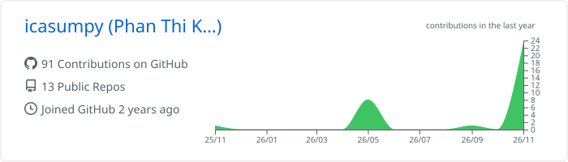
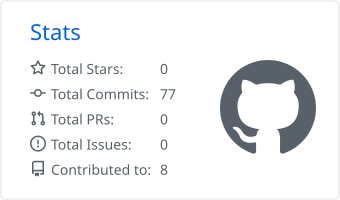
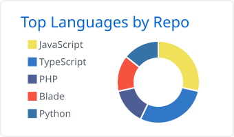

 

## 🌷 About Me

- 🎓 Software Engineering Student
- 💻 Interested in Web Development & Software Testing
- 🌱 Currently learning Java, React and Japanese
- 🇯🇵 Interested in working in the Japanese IT industry
- ✨ Always learning and building something new

## 🛠️ Tech Stack

## 📊 GitHub Statistics

## 🐍 Contribution Snake

## 💌 Connect with Me

*Thanks for visiting my little corner of GitHub! 🌸*

